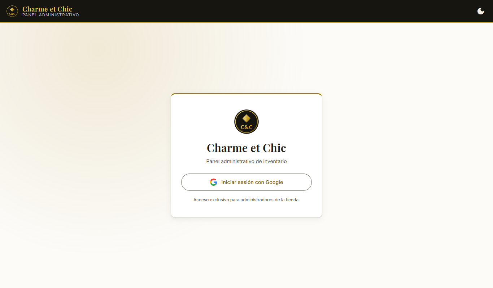
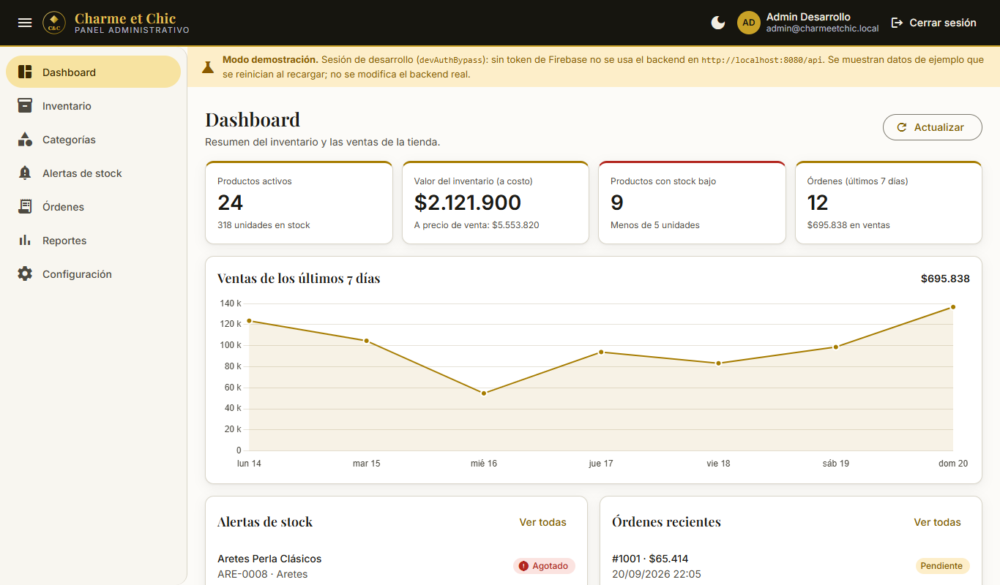
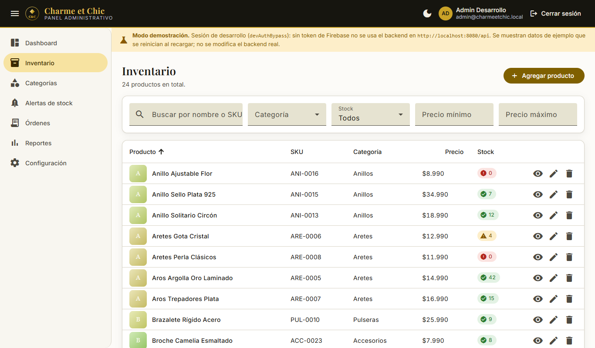
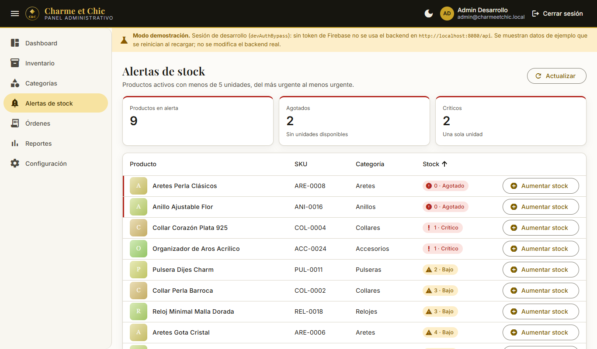

# Charme et Chic – Panel administrativo

Panel web para administrar el inventario de la tienda de accesorios y joyas **Charme et Chic**: productos,
categorías, alertas de stock, órdenes y reportes de ventas. Es el frontend de administración del proyecto
hermano [`charmeetchic_api`](../charmeetchic_api) (Spring Boot) y se autentica con **Firebase Authentication
(Google Sign-In)**. Solo pueden usarlo usuarios con el rol `ADMIN`.

| Login | Dashboard |
| --- | --- |
|  |  |
| **Inventario** | **Alertas de stock** |
|  |  |

Más capturas en [`docs/screenshots`](docs/screenshots): órdenes, reportes, tema oscuro y vista móvil.
Las capturas usan los datos de ejemplo del modo desarrollo.

## Stack

Angular 22 (componentes standalone, signals) · Angular Material 3 · Firebase Authentication con
`@angular/fire` · Chart.js · Vitest. Responsive (mobile-first), tema claro/oscuro, paleta dorado/plata/negro.

## Cómo ejecutarlo

Requisitos: Node `^22.22.3`, `^24.15` o superior (lo exige Angular 22; probado con 22.22.3) y npm.

```bash
npm ci          # instala las dependencias exactas del package-lock.json
npm start       # = ng serve  →  http://localhost:4200
```

> Si `npm install` (sin lockfile) falla con `Cannot read properties of null (reading 'edgesOut')`, es un bug de
> npm 10.9.x al resolver peers de `vitest/jsdom`; usa `npm ci`, o actualiza npm (`npx npm@latest install`).
> Si agregas dependencias con un npm distinto, revisa que `npm ci` siga funcionando con el npm de tu equipo.

Otros comandos:

```bash
npm test -- --no-watch   # pruebas unitarias (Vitest)
npm run build            # build de producción en dist/ (usa environment.prod.ts)
```

### Modo desarrollo: funciona sin Firebase ni backend

Con la configuración por defecto (`src/environments/environment.ts`) el panel arranca y se puede recorrer
completo sin nada más:

| Bandera | Por defecto (dev) | Qué hace |
| --- | --- | --- |
| `devAuthBypass` | `true` | Botón "Entrar (sesión de desarrollo)": sesión de administrador **simulada**, sin Firebase. Se ignora si `production` es `true`. |
| `mockFallback` | `true` | Con sesión de desarrollo, o si el backend no responde, usa datos de ejemplo en memoria (con las mismas reglas del backend real). Un banner lo indica. **No modifica el backend real.** |

Para usar Firebase y el backend real: completa `firebase` (abajo) y pon `devAuthBypass: false`
(y `mockFallback: false` si no quieres el respaldo). En `environment.prod.ts` ambas ya están en `false`.

## Autenticación con Firebase

### Flujo

1. **Login**: el botón abre el popup de Google (`signInWithPopup`); Firebase emite un ID token (JWT).
2. **Token en cada petición**: `authInterceptor` agrega `Authorization: Bearer <ID token>` **solo** a las URLs
   de `environment.apiUrl`. El token se pide en cada llamada: Firebase lo renueva solo (dura 1 hora).
3. **Rol**: Firebase solo dice *quién* es el usuario. El backend valida el JWT y decide si es administrador según
   sus *custom claims*; el panel lo consulta con `GET /profile` y exige `ADMIN` (`authGuard` + `adminGuard`).
4. **Sesión**: Firebase la guarda en el navegador; al recargar, el panel la restaura y vuelve a consultar el rol.
   Un 401 del backend con sesión activa cierra la sesión y vuelve al login.

### Configuración

1. En [Firebase Console](https://console.firebase.google.com) crea un proyecto (p. ej. `charmeetchic`).
2. *Authentication → Sign-in method*: habilita **Google**. En *Settings → Authorized domains* debe figurar
   `localhost` (viene por defecto) y, más adelante, el dominio de producción.
3. *Project settings → General → Your apps*: registra una app web y copia su configuración en
   `src/environments/environment.ts` (y `environment.prod.ts`):

```ts
firebase: {
  apiKey: '...',
  authDomain: 'charmeetchic.firebaseapp.com',
  projectId: 'charmeetchic',
  storageBucket: 'charmeetchic.appspot.com',
  messagingSenderId: '...',
  appId: '...',
},
devAuthBypass: false,
```

   La `apiKey` de una app web de Firebase **no es un secreto** (identifica el proyecto; la seguridad la dan las
   reglas y la validación del token en el backend). Este repositorio ya trae la configuración del proyecto
   `charme-et-chic` en ambos `environment`. Mientras queden valores `REEMPLAZAR-…`, el login lo avisa y
   se deshabilita.
4. **Backend**: `charmeetchic_api` valida los tokens contra el proyecto de `firebase.project-id`
   (variable `FIREBASE_PROJECT_ID`, por defecto `charmeetchic`; para este proyecto arráncalo con
   `FIREBASE_PROJECT_ID=charme-et-chic`). **Debe coincidir con `firebase.projectId`** del
   panel; si no, el panel muestra "El servidor rechazó tu token de Firebase".
5. **Dar el rol de administrador**: el backend lee los custom claims del token (`roles: ["ADMIN"]`, `role: "ADMIN"`
   o `admin: true`). Se asignan con el Admin SDK (por ejemplo en un script Node con credenciales del proyecto):

```js
import { initializeApp, applicationDefault } from 'firebase-admin/app';
import { getAuth } from 'firebase-admin/auth';

initializeApp({ credential: applicationDefault(), projectId: 'charmeetchic' });
const user = await getAuth().getUserByEmail('admin@tu-dominio.cl');
await getAuth().setCustomUserClaims(user.uid, { roles: ['ADMIN'] });
```

   El claim viaja en el ID token, que dura una hora: quien ya tenía sesión debe **cerrar sesión y volver a entrar**
   para que el rol se refleje.

### Desarrollar contra el emulador de Firebase Auth (opcional)

Permite probar el login real sin crear un proyecto. Levanta el emulador
(`npx firebase-tools emulators:start --only auth --project demo-charmeetchic`) y define en `environment.ts`
`authEmulatorUrl: 'http://127.0.0.1:9099'`, `devAuthBypass: false` y un `firebase.projectId` que empiece con
`demo-` (los demás campos de `firebase` pueden ser cualquier texto que no empiece con `REEMPLAZAR`). El popup del
emulador deja crear usuarios de prueba. Los tokens del emulador **no van firmados**, así que el backend real no
los acepta: sirve para el flujo del panel, no para llamar al backend.

### Sobre `@angular/fire`

`@angular/fire` **no declara soporte para Angular 22** (su última versión estable, 20.x, pide `@angular/core ^20`).
Se usa igualmente, con un `overrides` en `package.json` limitado a ese paquete que le permite resolver sus peers
con Angular 22. Funciona (login por popup, sesión persistente y tokens verificados con el emulador), pero es una
combinación no soportada oficialmente: al actualizar Angular o AngularFire, vuelve a probar el login. Si dejara de
funcionar, la alternativa es usar el SDK `firebase` directamente: solo `auth.service.ts` y `app.config.ts` lo
importan.

## Backend que consume (`http://localhost:8080/api`)

El contrato está tomado del código de `charmeetchic_api`. Todas las llamadas salen por `ApiService`.

| Uso en el panel | Endpoint | Acceso |
| --- | --- | --- |
| Rol del usuario | `GET /profile` | autenticado |
| Listar / paginar productos | `GET /products?page&size&sort` (y `/products/search?category=`) | público |
| Detalle de producto | `GET /products/{id}` | público |
| Crear / editar / dar de baja | `POST /products`, `PUT /products/{id}`, `DELETE /products/{id}` | ADMIN |
| Stock bajo | `GET /products/low-stock` | ADMIN |
| Categorías | `GET/POST /categories`, `PUT/DELETE /categories/{id}` | GET público, resto ADMIN |
| Órdenes | `GET /orders`, `PUT /orders/{id}/status` | USER / ADMIN |
| Reportes | `GET /reports/sales`, `/sales-by-category`, `/top-products`, `/inventory-value` | ADMIN |

### Limitaciones del backend actual (y cómo las resuelve el panel)

- **`GET /orders` devuelve solo las órdenes del usuario del token**, no las de todos los clientes. No existe un
  listado global para administradores, así que la pantalla *Órdenes* y las "órdenes recientes" del dashboard
  mostrarán solo las órdenes propias del administrador. **Pendiente en el backend:** un endpoint de listado
  para ADMIN (p. ej. `GET /orders/admin`). Las ventas del dashboard y los reportes sí son globales (vienen de `/reports`).
- **Cambio de estado**: el backend solo permite avanzar al estado inmediatamente siguiente
  (`PENDING → PROCESSING → SENT → DELIVERED`), y su CORS no admite `PATCH`. El panel usa `PUT` y ofrece el botón "Pasar a …".
- **Baja lógica**: `DELETE /products/{id}` desactiva el producto. Los inactivos no se listan ni se pueden consultar
  por la API pública, así que desde el panel no se pueden reactivar.
- **Filtros de precio y stock, y búsqueda por SKU** no existen en el servidor (`/products/search` busca en nombre y
  descripción). Cuando se usan, el panel descarga el catálogo (páginas de 100) y filtra en el cliente. Conviene
  para catálogos pequeños/medianos; con miles de productos habría que agregar esos filtros al backend.
- Los productos llegan **planos** (`categoryId` + `categoryName`) y con `version` (bloqueo optimista): el panel
  reconstruye `category` y reenvía `version` al editar; si otro usuario lo modificó, el backend responde 409.
- El umbral de "stock bajo" es `app.inventory.low-stock-threshold` del backend (5 por defecto); el panel usa
  el mismo valor en `src/app/shared/constants.ts`. Si lo cambias en el backend, cámbialo también allí.

## Estructura

```
src/app/
├── app.component.*          shell: header, menú lateral, banners de modo demo
├── app.config.ts            providers: HTTP + interceptores, Firebase (App y Auth), locale es-CL
├── app.routes.ts            rutas raíz; cada módulo se carga bajo demanda (lazy)
├── modules/
│   ├── auth/                pantalla de login (Google)
│   └── admin/               dashboard, inventario, categorías, alertas de stock,
│                            órdenes, reportes, configuración + admin.routes.ts
└── shared/
    ├── components/          header, sidebar, loading-spinner, confirm-dialog, chart
    ├── services/            AuthService (Firebase), ApiService, ProductService, backend simulado…
    ├── guards/              authGuard, adminGuard
    ├── interceptors/        auth (Bearer + 401) y error (mensajes + log)
    └── models/              Product, Category, Order, ReportData…
```

Rutas: `/login` (público) y `/dashboard`, `/inventory`, `/categories`, `/stock-alerts`, `/orders`, `/reports`,
`/settings` (solo admin).

### Agregar un módulo nuevo (p. ej. tienda pública)

Crea `src/app/modules/<nombre>/<nombre>.routes.ts` y agrégalo en `app.routes.ts` con
`loadChildren: () => import(...)`. Los servicios, modelos, guards e interceptores de `shared/` se reutilizan.

## Notas de implementación

- **Datos y errores**: los errores del backend (`ApiError` con `fieldErrors`) se traducen a mensajes claros;
  el interceptor los muestra en un snackbar y los registra en consola.
- **CSV**: separador `;` y BOM UTF-8 (Excel en español); las celdas que empiezan con `= + - @` se neutralizan.
- **Accesibilidad**: los estados (stock, órdenes) usan ícono + texto, no solo color; los gráficos incluyen una tabla oculta para lectores de pantalla.
- **Diferencias con el enunciado original**: componentes *standalone* (Angular 22) en lugar de `NgModule`, por lo que
  los archivos de rutas son `*.routes.ts`; el logo es `assets/logo.svg` (reemplázalo por el logo real); los modelos
  `Product`/`Order` se ajustaron a las respuestas reales del backend.
- **Diferencias con el enunciado de Firebase**: los guards son funciones (`authGuard`/`adminGuard`) en vez de una
  clase `CanActivate`, y la sesión se expone con *signals* (`isAuthenticated()`, `getUser()`…) en lugar de
  observables: la sesión se restaura **antes** de evaluar las rutas, así no hay parpadeos ni carreras al recargar.
  No se incluye Firestore (nada del panel lo usa). `AuthService` vive en `shared/services`.

## Qué está verificado

- Pruebas unitarias (55): lógica de productos, CSV, guards, errores, `AuthService` (modo desarrollo) y
  `ApiService` contra JSON con la forma real del backend.
- Recorrido completo en navegador en modo desarrollo (todas las pantallas, formularios, filtros, diálogos, tema
  oscuro y móvil) y build de producción.
- **Login con Firebase**, contra el emulador de Firebase Auth y un backend de prueba (25 comprobaciones): popup de
  Google, retorno a la ruta pedida, JWT con `iss`/`aud` del proyecto en cada llamada, una sola consulta a `/profile`,
  sesión persistente al recargar, logout, usuario sin rol, popup cerrado sin error, y 401 del backend.
- **No verificado**: el login con un proyecto real de Firebase (requiere tus credenciales) ni las operaciones
  autenticadas contra `charmeetchic_api` con un token real. El contrato sale del código del backend.
